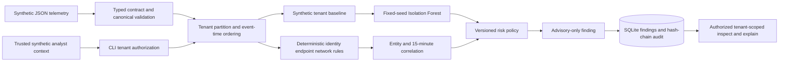

# Architecture and recovery boundaries

## Isolation and processing

`tenant_id` is required on every event, finding and audit record. A trusted local caller-to-tenant mapping authorizes the requested tenant; the CLI tenant value is only a requested scope. A mixed-tenant input is rejected instead of silently filtered. `validate-fixtures` performs this validation without state creation. Stored findings and `explain-finding` lookups both require a tenant predicate, so a known finding ID does not disclose another tenant's record.

Correlation does not arise merely because records share a tenant or time window. An endpoint rule must bridge identity evidence by the same `principal_ref` and/or network evidence by the same `host_ref`, with every evidence record in the 15-minute window. The tenant-local baseline is the only training input to Isolation Forest. An anomaly adds one bounded bonus only when rule evidence is already correlated; it cannot independently create a high-confidence finding.

## Persistence and recovery

SQLite commits individual finding persistence and each audit append transactionally. The audit record hash includes the prior hash and canonical sanitized payload, so later tampering is detected by `verify()`. Finding IDs are deterministic from a supplied run, tenant and canonical evidence identifiers; re-running the same analysis with the same run replaces the same finding record rather than creating a second finding identity. A new CLI invocation intentionally receives a new run ID and creates its own local audit evidence. This local design does not claim multi-store atomicity, WORM retention, distributed recovery, or concurrent-writer guarantees.

## Operational boundary

Structured logs include only UTC time, correlation run ID, tenant, bounded counts, finding ID and outcome. They do not include raw telemetry payloads, entity references, URL-like values, credentials or recommendation inputs. The pipeline makes advisory findings only; it does not call a ticketing system, block traffic, modify identity, or execute remediation.
